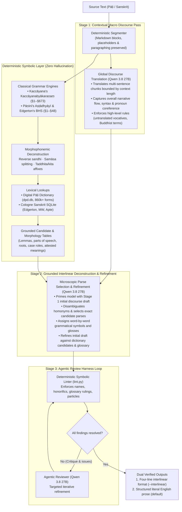

# Kavi

A literal Pāḷi and Sanskrit → English translator and word-by-word analyser that runs entirely on your Mac.

---

## Neurosymbolic Architecture

Kavi is built on a **neurosymbolic** approach: combining deterministic classical grammar deconstruction and
exhaustive dictionary databases with neural grounded translation and reasoning in an agentic loop.

Classical languages like Pāḷi and Sanskrit possess rich synthetic morphology, pervasive sandhi, and complex
compounding (*samāsa*). Pure end-to-end LLM translation frequently suffers from hallucinated roots, missed particles,
invented etymologies, and lapses into standard Victorian/theological paraphrases. Conversely, pure rule-based parsers
struggle with semantic ambiguity, homonym selection, and fluent English sentence synthesis.

Kavi bridges both paradigms:



1. **Symbolic Foundation (Deterministic Grammars & Lexicons)**:
   - **Codified Grammatical Engines**: Complete rule sets from Mahākaccāyana's *Kaccāyanabyākaraṇaṃ* (`kavi.kaccayana`)
     for Pāḷi and Pāṇini's *Aṣṭādhyāyī* (`kavi.panini`) for Sanskrit. These deterministically resolve euphonic sandhi,
     unbundle multi-word compounds (*samāsa*), undo secondary affixation with reverse *vuddhi* (*taddhita*), deconstruct
     verbal participles to root + affix (*kita/kṛdanta*), and map syntactic case government (*kāraka*).
   - **Exhaustive Lexical Lookups**: The Digital Pāḷi Dictionary (`dpd.db`) and Cologne Digital Sanskrit Dictionaries
     (Edgerton BHS, Monier-Williams, Apte) supply exact lemmata, inflection tags, and attested meanings for every token.
   - **Deterministic Checker**: A rule-based linter (`lint.py`) mechanically enforces mandatory technical terms,
     restores untranslated personal/place names in stem form, protects honorifics, and flags dropped particles.
2. **Neural Grounded Translation (LLM in an Agent Harness)**:
   - **Grounded Generation**: The LLM is never asked to generate translations from unguided parametric memory. It is
     fed the exact candidate table produced by the symbolic engines. Its neural role is to resolve contextual homonym
     ambiguities, select the most coherent morphological parse, assign word-by-word glosses, and arrange the components
     into a literal, faithful English sentence.
   - **Agentic Self-Improving Loop**: A unified model (`Qwen3.8-27B`) operates inside an iterative review harness.
     When the symbolic checker or reviewer detects an open issue, the model is prompted with the reviewer's structured
     critique and its own prior draft to systematically revise the sentence until all constraints are met.

---

## Unified Translation Pipeline

Kavi uses a single unified 3-stage translation pipeline regardless of whether output is requested as four-line
interlinear or standard running prose:

1. **Stage 1 — Contextual Macro Discourse Pass**:
   - The source text is broken into multi-sentence segments bounded by the model's context window.
   - Qwen 3.8 performs an initial contextual translation of the entire segment using a rationalist, literal prompt
     (preserving Buddhist technical terms, keeping vocatives untranslated in stem form, and observing conventions
     such as *Thus heard by me*).
   - This establishes global discourse continuity, natural English sentence structure, and coherent pronoun resolution
     across paragraph boundaries.
2. **Stage 2 — Grounded Interlinear Deconstruction & Refinement**:
   - Every sentence is split into units and deconstructed through the classical grammar engines (Kaccāyana/Pāṇini)
     and dictionary databases (DPD/Cologne).
   - The model is supplied with both the Stage 1 contextual draft and the microscopic dictionary candidates.
   - It performs morphological selection, assigns grammatical symbols and word glosses, and iteratively refines the
     initial translation into an exact, grounded sentence faithful to every particle and case ending.
3. **Stage 3 — Agentic Review Harness Loop**:
   - The deterministic linter (`lint.py`) checks the translation against the glossary, name registries, and particle rules.
   - If discrepancies are found, the agentic reviewer provides structured critique back to the model for iterative
     refinement until all criteria are satisfied.
4. **Dual Output Formatting**:
   - **Interlinear Mode** (`--interlinear`): Emits the textbook's four-line form: source sentence, grammatical symbols,
     word glosses, and English translation.
   - **Prose Mode** (default): Uses the exact same underlying translation and word choices, omitting the interlinear
     grammatical lines while preserving all original document layout, paragraphing, headings, and verse breaks.

---

## Why MITRA Models Were Abandoned

Previous versions of Kavi used Dharmamitra's `buddhist-nlp/mitra-qwen35-translate` (9B) paired with `mitra-qwen35-it`.
Through extensive evaluation across canonical Pāḷi suttas and Sanskrit texts, the two-model MITRA setup proved
unviable and was abandoned for the following reasons:

1. **Inability to Follow Strict Instructions & Negative Constraints**:
   - `mitra-translate` is a translation-completion model rather than a general instruction-following agent. Despite
     explicit prompts and negative constraints, it persistently lapsed into Victorian / Pali Text Society (PTS)
     conventions: translating *sambodhi* as "enlightenment" (strictly forbidden by author ruling; must be *full awakening*),
     *dukkha* as "suffering" (must be *dissatisfaction*), *evaṃ me sutaṃ* as "Thus have I heard" (must be *Thus heard by me*),
     and translating personal names or titles (rendering *bhagavā* as "the Lord" or "the Blessed One").
2. **Breakdown of the Agentic Self-Improving Loop**:
   - The intended design was for a review model to critique the draft and for the translator to incrementally revise its
     work. However, `mitra-translate` could not take structured review critique (e.g. "Do not translate *bhagavā*; use
     *dissatisfaction* for *dukkha*") and apply targeted corrections. It either ignored the critique completely or
     regenerated unrelated text with fresh hallucinations.
3. **Superiority of a Unified 27B Model in an Agent Harness**:
   - Modern 27B instruction models (specifically **Qwen 3.8 27B**) possess the reasoning capacity to simultaneously
     respect dictionary analysis tables, obey mandatory glossary constraints, output valid machine-readable JSON for
     interlinear tokens, and revise their own drafts in response to reviewer critique.
   - Replacing the fragile two-model pipeline with a single unified model running an agentic critique loop produced an
     immediate, dramatic improvement in translation literalness, accuracy, and glossary compliance.

### Evaluation of Alternative Models

We empirically benchmarked candidate architectures on Apple Silicon unified memory:

* **Qwen 3.8 27B** *(Default)*: Exceptional instruction adherence (100% compliance on tested glossary rulings),
  emits clean JSON without markdown wrappers, and sustains a steady 15–20 tokens/sec.
* **Gemma 3 27B** (*bf16*): In unquantised bf16 (~54 GB), memory bus bandwidth limits generation to **3–5 tokens/sec**
  (4x slower than Qwen). Furthermore, it suffers from conversational verbosity, appending unsolicited breakdown
  commentary that disrupts automated parsers.
* **Gemma 4 26B-A4B** (*MoE*): Extremely fast (50–80 tokens/sec), but its 4B active parameter budget lacks the capacity
  for classical languages. It suffers from severe undertranslation (leaving strings of raw Pāḷi words untranslated),
  stem truncation (dropping compound affixes), and markup leakage.
* **Gemma 4 31B**: Capable instruction following (12–14 tokens/sec in 4-bit), but defaults to internal reasoning
  channels (`<|channel>thought`) that require aggressive regex stripping, and in bf16 is memory-bound (~3 tokens/sec).

---

## Dual Grammatical Rule Engines

Kavi incorporates codified classical grammar engines for both Pāḷi and Sanskrit:

### 1. Pāḷi: Mahākaccāyana's *Kaccāyanabyākaraṇaṃ* (`src/kavi/kaccayana.py` & `src/kavi/sandhi.py`)
Codifies rules from the eight chapters of Kaccāyana (as published on [kaccayana.github.io](https://kaccayana.github.io)):
* **Sandhikappa (§1–§51)**: Elision of vowels (§12 *sarā sare lopaṃ*, §13 *vā paro asarūpā*), qualitative changes (§14),
  lengthening (§15), consonantalization (§17–§18), euphonic augments (§35 *y-v-m-d-n-t-r-l-ḷ*), and prefix assimilation
  (§44 *abbho abhi*, §45 *ajjho adhi*, §47 *atissa canatassa*).
* **Nāmakappa (§52–§270)**: Consonant declension and the *mano-gaṇa* class (§197–§205: *manas*, *cetas*, *tapas*, *yasas*,
  *tejas*, *vācas*, *āyus*) inflecting with nominative `-o`, instrumental `-asā`, genitive `-aso`, and compound stem `-o-`.
* **Kārakakappa (§271–§315)**: The six *kārakas* (*kattā* agent §281, *kamma* patient §280, *karaṇa* instrument §279,
  *sampadāna* recipient §276, *apādāna* source §271, *okāsa/ādhāra* location §278) and case government rules (§287 *saha*,
  §294 *namo*, §282 fear verbs, §298 continuous duration, §313 locative absolute).
* **Samāsakappa (§316–§343)**: Compound member inflection elision (§317), stem reversion (§318), *mahanta* $\rightarrow$
  *mahā* (§330), negative *na* $\rightarrow$ *a-/an-* (§333), and *samāsānta* final stem changes (§335: *rāja* $\rightarrow$
  *rājan*, *sakha* $\rightarrow$ *sakhi*, *akkha* $\rightarrow$ *akkhi*).
* **Taddhitakappa (§344–§405)**: Reverse *vuddhi* (§396, §400: `ā` $\rightarrow$ `a`, `e` $\rightarrow$ `i`, `o` $\rightarrow$ `u`),
  and secondary suffixes: `-ika` (§350), `-tta`/`-tā` (§361), `-vantu`/`-mantu` (§364), `-ī` (§367), `-maya` (§372),
  and adverbs `-to` (§393) and `-so` (§394).
* **Kibbidhānakappa (§524–§623)**: Primary verbal derivations: present participles in `-anta`/`-māna` (§527), gerundives in
  `-tabba`/`-anīya` (§528), agent nouns in `-aka`/`-tar` (§531–§532), past participles in `-ta`/`-na` (§555–§556),
  infinitives in `-tuṃ` (§561), and absolutives in `-tvā`/`-ya` (§563, §597).

### 2. Sanskrit & Buddhist Hybrid Sanskrit: Pāṇini & Edgerton (`src/kavi/panini.py`, `src/kavi/bhs.py`)
* **Pāṇini's *Aṣṭādhyāyī***: Ac-sandhi (6.1), hal-sandhi (8.2–8.4), visarga/rutva sandhi (6.1, 8.2–8.3), retroflexion (*ṇatva*
  8.4.1–2, *ṣatva* 8.3.59), *cvi* formations (5.4.50), *samāsānta* stem changes (5.4.68–154), initial *vṛddhi* in *taddhita*
  (7.2.117), and `-tṛ` agent nouns (3.1.133).
* **Edgerton's BHS Grammar**: 48 codified Buddhist Hybrid Sanskrit morphophonemic rules with section citations.
* **Cologne Dictionaries**: Integrated SQLite lookups across Edgerton's *BHS Dictionary*, Monier-Williams (1899), and Apte (1890).

---

## Hardware & Memory Tiers

Kavi detects system unified memory via `sysctl hw.memsize` and automatically selects the highest unquantised or
quantised precision tier that fits comfortably in RAM:

| System RAM | Default Model Identifier | Precision | Resident Footprint | Speed |
| :--- | :--- | :--- | :--- | :--- |
| **$\ge 100$ GB** (128 GB tier) | `mlx-community/Qwen3.8-27B-bf16` | **bf16** (unquantised) | ~51 GB | ~15 tok/s |
| **$\ge 50$ GB** (64 GB tier) | `mlx-community/Qwen3.8-27B-8bit` | **8-bit** quantised | ~28 GB | ~18 tok/s |
| **$< 50$ GB** (32 GB tier) | `mlx-community/Qwen3.8-27B-4bit` | **4-bit** quantised | ~15 GB | ~20 tok/s |

Override the model at any time with the `--model` flag or by setting the `KAVI_MODEL` environment variable.

---

## Data

* **Pāḷi Data**: Place `dpd.db` (CC BY-NC-SA 4.0, Bodhirasa Bhikkhu) and `deconstructor_output.json` in `./data/`
  (or set `$KAVI_DATA_DIR`). Download from https://github.com/digitalpalidictionary/dpd-db/releases.
* **Sanskrit Data**: Run `uv run kavi setup --sanskrit` to download Vidyut's kosha and Cologne dictionary files
  into `./data/` and compile `./data/sanskrit.sqlite`.

---

## Install and Run

```bash
uv sync                                          # Python 3.12, mlx-lm, streamlit, vidyut
uv run kavi setup                                # download lexical data and default model
uv run kavi doctor                               # verify data and model status
uv run kavi translate sutta.md -o sutta.en.md    # running prose translation
uv run kavi translate sutta.md --interlinear     # 4-line textbook interlinear format
uv run kavi translate --lang sa heart.md         # Sanskrit / Buddhist Hybrid Sanskrit
uv run kavi app                                  # Streamlit interface
```

### Key CLI Flags
* `--interlinear`: Produce 4-line interlinear output instead of standard prose.
* `--model <name>`: Specify a local MLX model path or Hugging Face repo (e.g. `mlx-community/Qwen3.8-27B-bf16`).
* `--lang <pi|sa>`: Select language: `pi` Pāḷi (default) or `sa` Sanskrit.
* `--rounds N`: Maximum review critique rounds per batch (default 5).
* `--glossary FILE`: Technical terms glossary (default `src/kavi/glossaries/default.txt`).
* `--batch-words N`: Review batch size in source words (default 400).

---

## Licence

Code: CC0. The Digital Pāḷi Dictionary (DPD) is CC BY-NC-SA 4.0 (consulted, not redistributed). Vidyut is MIT.
Cologne Digital Sanskrit Dictionaries are CC BY-NC-SA 3.0 (consulted, not redistributed).
